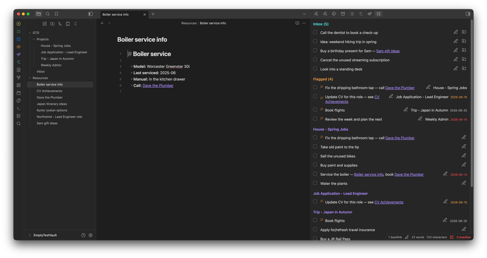
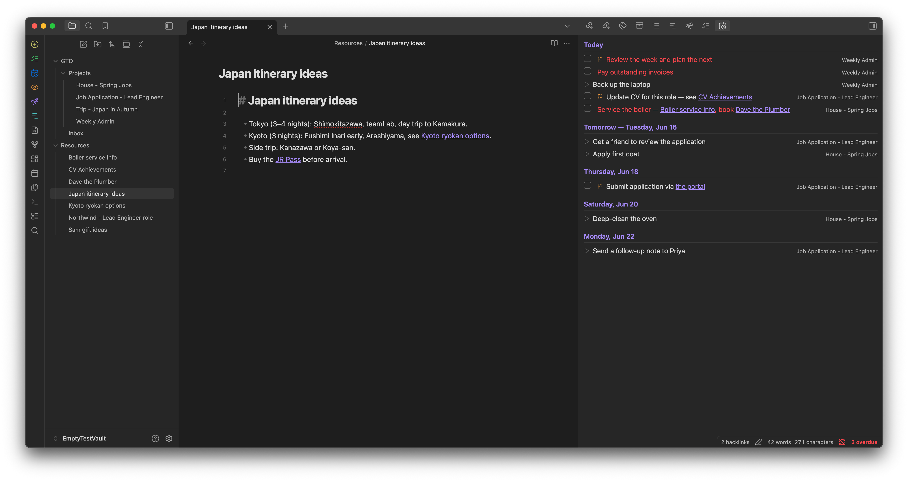
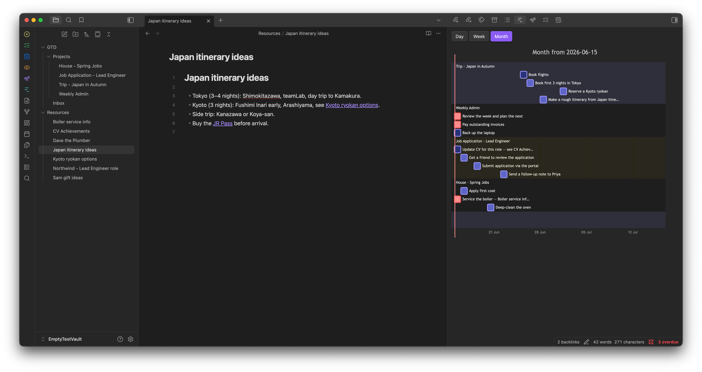
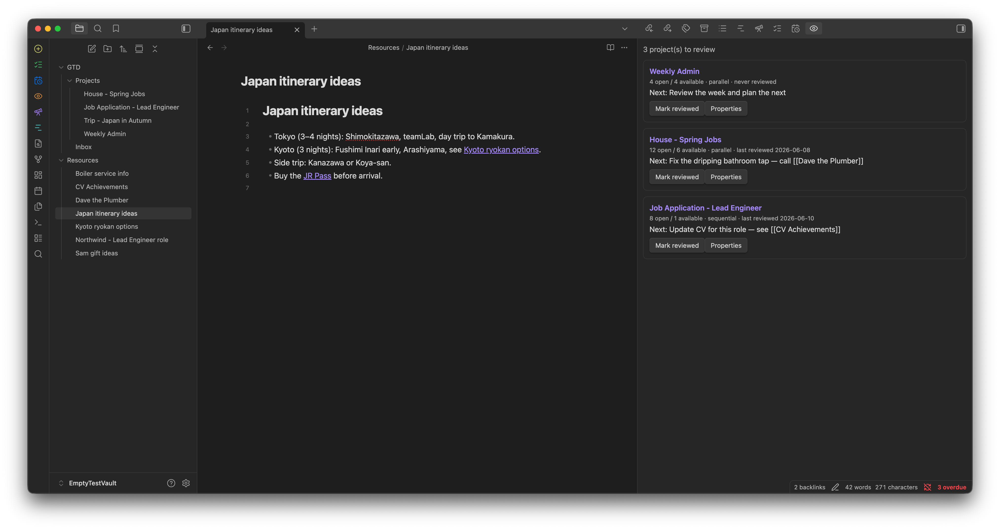
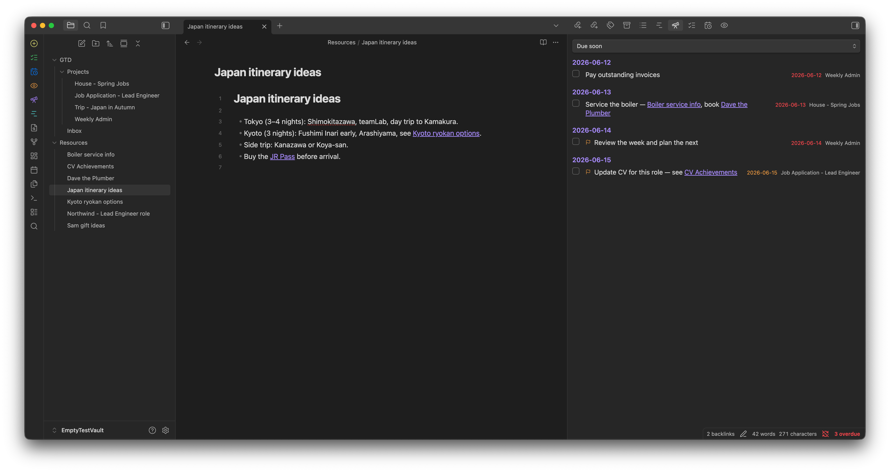
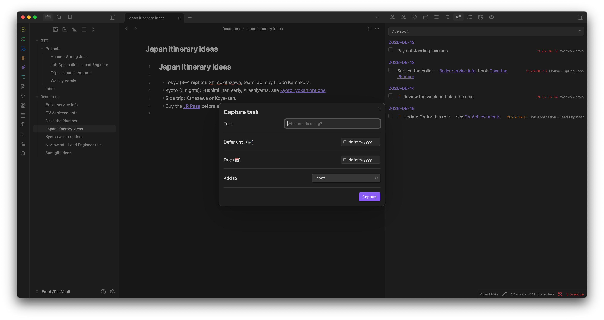
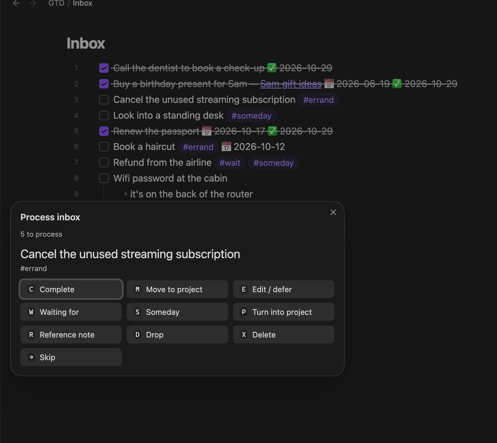

# GTD Flow

**GTD-style project and task management for [Obsidian](https://obsidian.md), built on plain Markdown.**

The whole GTD loop — capture, process, organise, do, review — on ordinary notes and `- [ ]` lines. No hidden database: everything stays greppable, portable and readable with the plugin off. It speaks the [Tasks plugin](https://publish.obsidian.md/tasks) emoji syntax, so both can share the same files.

---

## Screenshots

| Next actions | Forecast | Timeline |
|---|---|---|
|  |  |  |

| Review | Perspectives | Capture |
|---|---|---|
|  |  |  |

---

## What's new

- **Process inbox** — one item at a time, one key per decision: complete, move to a project, defer, wait for someone, park as someday, turn into a project, file as reference, drop or delete. Also a ⋯ menu on every inbox row.
- **Waiting for** — tag a task `#wait/anna` when it's in someone else's hands. It stays in its project, stops being a next action, and shows in one list with who, how long, and when to follow up.

See the [changelog](CHANGELOG.md) for everything else.

## How it works

| You want | GTD Flow |
|---|---|
| A project | a note with `type: project`; `flow: sequential` or `parallel` |
| What to do next | **Next actions**: only tasks you can actually start now |
| Dates | `🛫` defer, `📅` due, `⏰` time, `⏱` duration, `🔁` repeat |
| Order across projects | `🆔` / `⛔` dependencies |
| Contexts | nested tags (`#home/plumbing`) and saved **Perspectives** |
| Not now | `#someday`, `#wait/who`, or `status: on-hold` |
| The week ahead | **Forecast** and a Gantt **Timeline** |
| Keeping it honest | **Review** queue, stalled-project detection, deadline warnings |
| What got done | `gtd-done` blocks and an exportable report |

Plus in-note editing (right-click menu, checkbox clicks that record `✅` and the next `🔁`), archiving, quick capture from anywhere via `obsidian://gtd-capture`, and per-project colours.

## Install

*Settings → Community plugins → Browse* → **GTD Flow**, or the [directory listing](https://obsidian.md/plugins?id=gtd-flow). Desktop and mobile. Pre-releases via [BRAT](https://github.com/TfTHacker/obsidian42-brat); manual install from a [release](../../releases) into `<vault>/.obsidian/plugins/gtd-flow/`.

## Quick start

1. Check the projects folder and inbox note in settings (defaults `GTD/Projects`, `GTD/Inbox.md`).
2. **New project**, then add `- [ ]` lines; type at the end of a line for dates and repeats.
3. Capture with the ribbon **+**, empty the inbox with **Process inbox**, work from **Next actions**.

## Documentation

**[MANUAL.md](MANUAL.md)** — everything, starting with a *How do I…?* table. **[CHANGELOG.md](CHANGELOG.md)** — what changed in each release.

## License

[MIT](LICENSE) © Marco Guidetti
